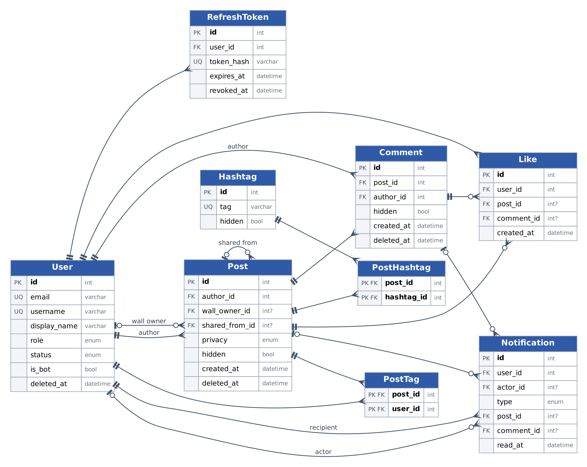
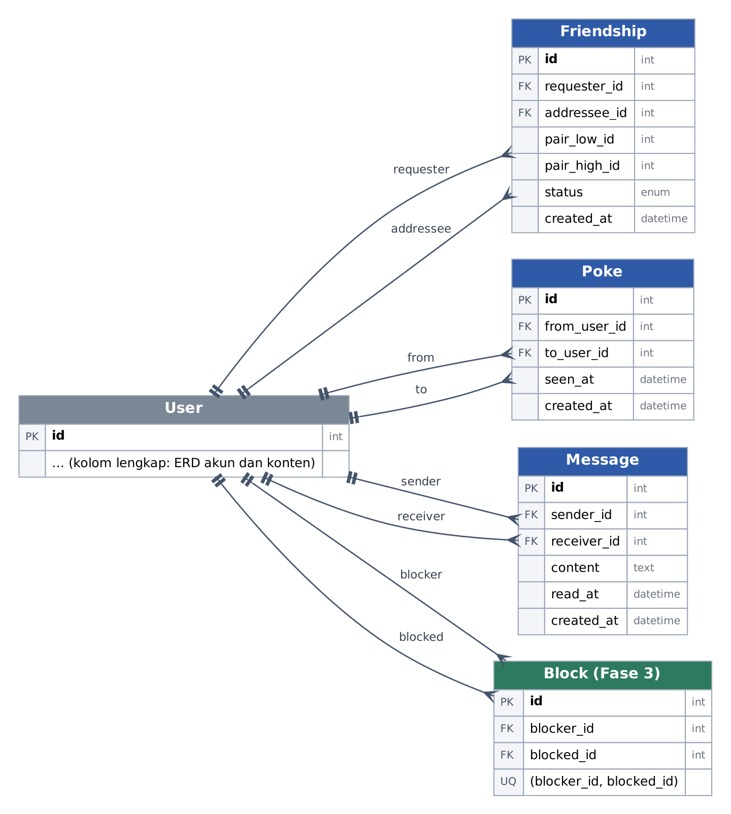
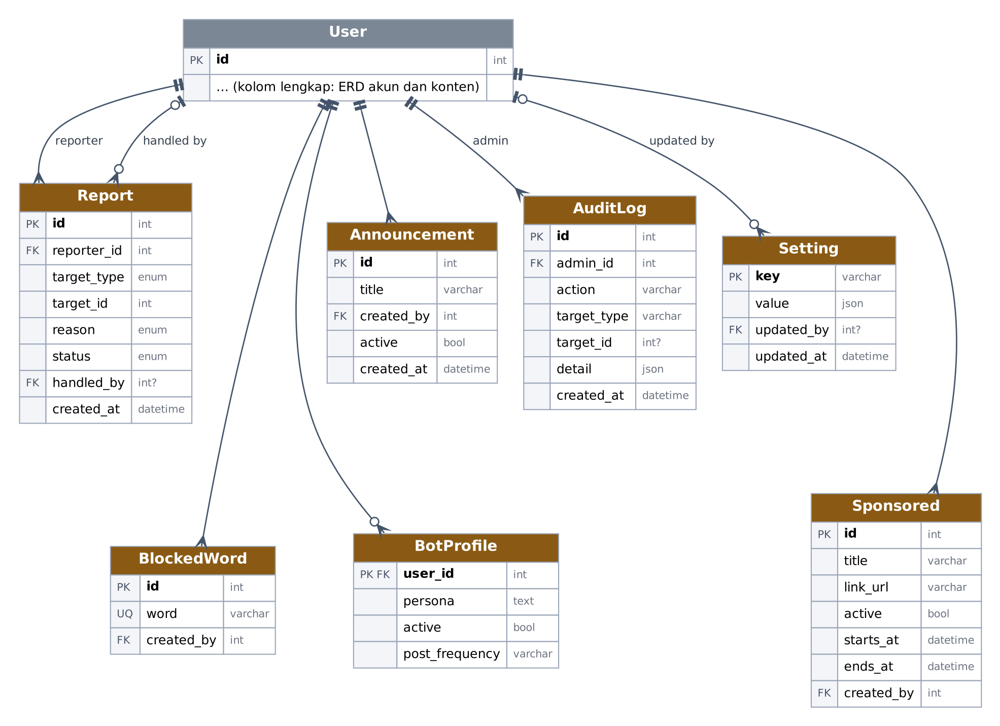
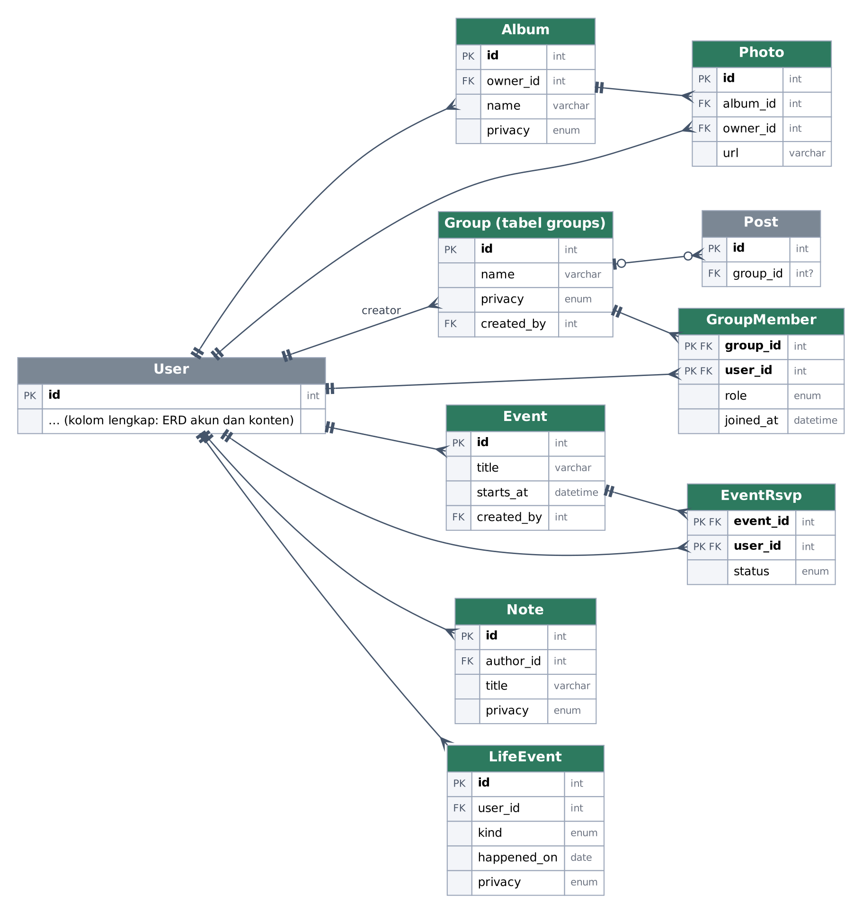

# ERD: Retro Social Network 2015 + Admin Panel

Nov 24, 2026 · @Ganjar Hadiatna

## 1. Ringkasan dan konvensi

Model data terdiri dari 28 tabel dalam MySQL (dikelola Prisma) yang mendukung semua kebutuhan di PRD; diagram memakai notasi kaki gagak dan warna menunjukkan kelompok.

- Biru: inti (Fase 1 dan 2). Coklat: admin dan moderasi. Hijau: Fase 3 dan Block. Abu-abu: entitas acuan yang digambar ulang agar relasi terbaca.

- Notasi: dua garis tegak berarti tepat satu; garis dengan lingkaran berarti nol atau satu; tiga cabang berarti banyak; tiga cabang dengan lingkaran berarti nol atau banyak.

- Diagram hanya menampilkan kolom kunci; semua kolom ada di kamus data (bagian 4).

| Konvensi            | Aturan                                                                                                         |
|---------------------|----------------------------------------------------------------------------------------------------------------|
| Penamaan            | Tabel snake_case jamak (users, posts) lewat @@map Prisma; model Prisma singular (User, Post); kolom snake_case |
| Primary key         | id INT auto-increment; tabel penghubung memakai primary key gabungan                                           |
| Waktu               | DATETIME dalam UTC; created_at pada hampir semua tabel; tampilan diubah ke zona waktu pengguna di frontend     |
| Soft delete         | Kolom deleted_at (NULL berarti aktif) pada users, posts, comments, messages, albums, notes                     |
| Penyembunyian admin | Kolom hidden (BOOL) pada posts dan comments, terpisah dari deleted_at                                          |
| Enum                | Enum Prisma (MySQL ENUM) untuk nilai tetap seperti role, status, privacy                                       |
| Teks                | VARCHAR dengan batas untuk teks pendek; TEXT untuk isi post, komentar, dan pesan                               |
| Foreign key         | Semua relasi dibatasi FK; aturan hapus tercantum di bagian 5                                                   |
| Relasi polimorfik   | Hanya reports.target_id yang tanpa FK; divalidasi di service                                                   |

## 2. ERD inti (Fase 1 dan 2)

Entitas inti dibagi dua gambar agar terbaca: akun dan konten, lalu relasi sosial dan chat.

### Akun dan konten

User menulis Post dan Comment, memberi Like, ditandai lewat PostTag, dan menerima Notification; Post bisa merujuk Post lain (share) dan dinding teman, dan terhubung ke Hashtag lewat PostHashtag.

### Relasi sosial dan chat

Friendship menyimpan satu baris per pasangan (kolom pair_low_id dan pair_high_id mencegah duplikat dua arah), sedangkan Poke dan Message mengikat dua user dengan arah; Block (Fase 3) ikut digambar di sini karena sifatnya relasi antar user.

## 3. ERD admin dan Fase 3

Entitas admin semuanya bermuara ke User (admin pembuat atau penangan), sedangkan entitas Fase 3 menambah album, grup, event, catatan, dan life event.

### Admin dan moderasi

Report mencatat pelapor dan admin penangan, AuditLog mencatat setiap aksi admin, dan BotProfile mengubah satu User menjadi akun bot (relasi satu ke nol atau satu).

### Komunitas dan konten Fase 3

Group memiliki anggota lewat GroupMember dan bisa memiliki Post (kolom group_id pada posts); Event memiliki RSVP, dan Album memiliki Photo.

## 4. Kamus data

Setiap tabel dijelaskan lengkap; tipe memakai notasi MySQL dan "null" berarti kolom boleh kosong. Bagian ini mencakup tabel inti; tabel admin dan Fase 3 menyusul di bawahnya.

### users

| Kolom         | Tipe                            | Constraint               | Keterangan                                             |
|---------------|---------------------------------|--------------------------|--------------------------------------------------------|
| id            | INT                             | PK, auto-increment       |                                                        |
| email         | VARCHAR(191)                    | UNIQUE, NOT NULL         | Huruf kecil                                            |
| username      | VARCHAR(30)                     | UNIQUE, NOT NULL         | 3 sampai 30 karakter: huruf, angka, titik, garis bawah |
| display_name  | VARCHAR(80)                     | NOT NULL                 | Nama yang tampil                                       |
| password_hash | VARCHAR(255)                    | NOT NULL                 | argon2 atau bcrypt; tidak pernah dikembalikan API      |
| role          | ENUM(USER, ADMIN)               | NOT NULL, default USER   |                                                        |
| status        | ENUM(ACTIVE, SUSPENDED, BANNED) | NOT NULL, default ACTIVE | Lihat BR-05                                            |
| is_bot        | BOOL                            | NOT NULL, default false  | Lihat BR-09                                            |
| bio           | TEXT                            | null                     |                                                        |
| avatar_url    | VARCHAR(255)                    | null                     |                                                        |
| cover_url     | VARCHAR(255)                    | null                     |                                                        |
| birthday      | DATE                            | null                     | Untuk birthday reminder                                |
| hometown      | VARCHAR(80)                     | null                     | Kartu info: From                                       |
| current_city  | VARCHAR(80)                     | null                     | Kartu info: Lives in                                   |
| workplace     | VARCHAR(120)                    | null                     |                                                        |
| school        | VARCHAR(120)                    | null                     | Kartu info: Studied at                                 |
| last_seen_at  | DATETIME                        | null                     | Presence                                               |
| created_at    | DATETIME                        | NOT NULL, default now    |                                                        |
| deleted_at    | DATETIME                        | null                     | Soft delete dan anonimisasi (BR-06)                    |

### refresh_tokens

| Kolom      | Tipe        | Constraint            | Keterangan                         |
|------------|-------------|-----------------------|------------------------------------|
| id         | INT         | PK                    |                                    |
| user_id    | INT         | FK users.id, NOT NULL |                                    |
| token_hash | VARCHAR(64) | UNIQUE, NOT NULL      | Hash token, bukan token asli       |
| expires_at | DATETIME    | NOT NULL              |                                    |
| revoked_at | DATETIME    | null                  | Diisi saat logout atau user di-ban |
| created_at | DATETIME    | NOT NULL              |                                    |

### posts

| Kolom          | Tipe                           | Constraint                | Keterangan                                                                 |
|----------------|--------------------------------|---------------------------|----------------------------------------------------------------------------|
| id             | INT                            | PK                        |                                                                            |
| author_id      | INT                            | FK users.id, NOT NULL     | Penulis                                                                    |
| wall_owner_id  | INT                            | FK users.id, null         | Terisi bila menulis di dinding teman                                       |
| shared_from_id | INT                            | FK posts.id, null         | Terisi bila post adalah share                                              |
| group_id       | INT                            | FK groups.id, null        | Post grup; SET NULL saat grup dihapus                                      |
| content        | TEXT                           | NOT NULL, default kosong  | Boleh kosong bila ada image_url; maksimal 5.000 karakter divalidasi di API |
| image_url      | VARCHAR(255)                   | null                      | Satu foto per post                                                         |
| feeling        | VARCHAR(40)                    | null                      | Contoh: feeling happy                                                      |
| privacy        | ENUM(PUBLIC, FRIENDS, ONLY_ME) | NOT NULL, default FRIENDS |                                                                            |
| flagged        | BOOL                           | NOT NULL, default false   | Memuat kata terlarang (BR-08), tidak menyembunyikan                        |
| hidden         | BOOL                           | NOT NULL, default false   | Disembunyikan admin                                                        |
| edited_at      | DATETIME                       | null                      | Penanda sudah diedit                                                       |
| created_at     | DATETIME                       | NOT NULL                  |                                                                            |
| deleted_at     | DATETIME                       | null                      | Soft delete                                                                |

### comments

| Kolom      | Tipe         | Constraint              | Keterangan                                |
|------------|--------------|-------------------------|-------------------------------------------|
| id         | INT          | PK                      |                                           |
| post_id    | INT          | FK posts.id, NOT NULL   |                                           |
| author_id  | INT          | FK users.id, NOT NULL   |                                           |
| content    | TEXT         | NOT NULL                | Maksimal 2.000 karakter divalidasi di API |
| image_url  | VARCHAR(255) | null                    | Fase 3                                    |
| flagged    | BOOL         | NOT NULL, default false | Memuat kata terlarang (BR-08)             |
| hidden     | BOOL         | NOT NULL, default false |                                           |
| created_at | DATETIME     | NOT NULL                |                                           |
| deleted_at | DATETIME     | null                    |                                           |

### likes

| Kolom      | Tipe     | Constraint                                                                                                    | Keterangan                                |
|------------|----------|---------------------------------------------------------------------------------------------------------------|-------------------------------------------|
| id         | INT      | PK                                                                                                            |                                           |
| user_id    | INT      | FK users.id, NOT NULL                                                                                         |                                           |
| post_id    | INT      | FK posts.id, null                                                                                             |                                           |
| comment_id | INT      | FK comments.id, null                                                                                          |                                           |
| created_at | DATETIME | NOT NULL                                                                                                      |                                           |
| (tabel)    |          | UNIQUE (user_id, post_id), UNIQUE (user_id, comment_id), CHECK tepat satu dari post_id atau comment_id terisi | Mencegah like ganda dan like tanpa target |

### post_tags, hashtags, post_hashtags

| Tabel         | Kolom                                                        | Constraint                                                     | Keterangan                                                 |
|---------------|--------------------------------------------------------------|----------------------------------------------------------------|------------------------------------------------------------|
| post_tags     | post_id, user_id                                             | PK gabungan; FK posts.id dan users.id                          | Teman yang di-tag pada post                                |
| hashtags      | id INT PK; tag VARCHAR(50); hidden BOOL; created_at DATETIME | UNIQUE (tag), huruf kecil                                      | hidden dipakai admin menyembunyikan dari trending (ADM-17) |
| post_hashtags | post_id, hashtag_id, created_at                              | PK gabungan (post_id, hashtag_id); FK posts.id dan hashtags.id | created_at untuk hitung trending 24 jam                    |

### friendships

| Kolom        | Tipe                    | Constraint                                                                            | Keterangan                                     |
|--------------|-------------------------|---------------------------------------------------------------------------------------|------------------------------------------------|
| id           | INT                     | PK                                                                                    |                                                |
| requester_id | INT                     | FK users.id, NOT NULL                                                                 | Pengirim permintaan                            |
| addressee_id | INT                     | FK users.id, NOT NULL                                                                 | Penerima                                       |
| pair_low_id  | INT                     | NOT NULL                                                                              | Nilai terkecil dari kedua id, dihitung service |
| pair_high_id | INT                     | NOT NULL                                                                              | Nilai terbesar dari kedua id, dihitung service |
| status       | ENUM(PENDING, ACCEPTED) | NOT NULL, default PENDING                                                             | Tolak atau batal menghapus baris               |
| created_at   | DATETIME                | NOT NULL                                                                              |                                                |
| responded_at | DATETIME                | null                                                                                  |                                                |
| (tabel)      |                         | UNIQUE (pair_low_id, pair_high_id), CHECK requester_id tidak sama dengan addressee_id | Satu baris per pasangan (BR-01)                |

### pokes

| Kolom        | Tipe     | Constraint                        | Keterangan                             |
|--------------|----------|-----------------------------------|----------------------------------------|
| id           | INT      | PK                                |                                        |
| from_user_id | INT      | FK users.id, NOT NULL             |                                        |
| to_user_id   | INT      | FK users.id, NOT NULL             |                                        |
| seen_at      | DATETIME | null                              | Kosong berarti poke masih aktif        |
| created_at   | DATETIME | NOT NULL                          | Diperbarui saat poke ulang             |
| (tabel)      |          | UNIQUE (from_user_id, to_user_id) | Poke ulang memperbarui baris yang sama |

### messages

| Kolom       | Tipe     | Constraint            | Keterangan    |
|-------------|----------|-----------------------|---------------|
| id          | INT      | PK                    |               |
| sender_id   | INT      | FK users.id, NOT NULL |               |
| receiver_id | INT      | FK users.id, NOT NULL |               |
| content     | TEXT     | NOT NULL              |               |
| read_at     | DATETIME | null                  | Tanda terbaca |
| created_at  | DATETIME | NOT NULL              |               |
| deleted_at  | DATETIME | null                  |               |

### notifications

| Kolom           | Tipe                                                                                   | Constraint                | Keterangan                      |
|-----------------|----------------------------------------------------------------------------------------|---------------------------|---------------------------------|
| id              | INT                                                                                    | PK                        |                                 |
| user_id         | INT                                                                                    | FK users.id, NOT NULL     | Penerima                        |
| actor_id        | INT                                                                                    | FK users.id, null         | Pelaku; kosong untuk pengumuman |
| type            | ENUM(LIKE, COMMENT, FRIEND_REQUEST, FRIEND_ACCEPT, POKE, TAG, WALL_POST, ANNOUNCEMENT) | NOT NULL                  |                                 |
| post_id         | INT                                                                                    | FK posts.id, null         |                                 |
| comment_id      | INT                                                                                    | FK comments.id, null      |                                 |
| announcement_id | INT                                                                                    | FK announcements.id, null | Untuk type ANNOUNCEMENT         |
| read_at         | DATETIME                                                                               | null                      |                                 |
| created_at      | DATETIME                                                                               | NOT NULL                  |                                 |

### blocks (T-13; UI manajemen blokir FRD-06 tetap Fase 3)

| Kolom      | Tipe     | Constraint                      | Keterangan    |
|------------|----------|---------------------------------|---------------|
| id         | INT      | PK                              |               |
| blocker_id | INT      | FK users.id, NOT NULL           | Pemblokir     |
| blocked_id | INT      | FK users.id, NOT NULL           | Yang diblokir |
| created_at | DATETIME | NOT NULL                        |               |
| (tabel)    |          | UNIQUE (blocker_id, blocked_id) |               |

### reports

| Kolom       | Tipe                                         | Constraint                                   | Keterangan                                  |
|-------------|----------------------------------------------|----------------------------------------------|---------------------------------------------|
| id          | INT                                          | PK                                           |                                             |
| reporter_id | INT                                          | FK users.id, NOT NULL                        |                                             |
| target_type | ENUM(POST, COMMENT, USER)                    | NOT NULL                                     |                                             |
| target_id   | INT                                          | NOT NULL                                     | Polimorfik, tanpa FK; divalidasi di service |
| reason      | ENUM(SPAM, HARASSMENT, INAPPROPRIATE, OTHER) | NOT NULL                                     |                                             |
| note        | TEXT                                         | null                                         | Catatan pelapor                             |
| status      | ENUM(PENDING, REVIEWED, DISMISSED)           | NOT NULL, default PENDING                    |                                             |
| handled_by  | INT                                          | FK users.id, null                            | Admin penangan                              |
| handled_at  | DATETIME                                     | null                                         |                                             |
| created_at  | DATETIME                                     | NOT NULL                                     |                                             |
| (tabel)     |                                              | UNIQUE (reporter_id, target_type, target_id) | Satu laporan per pelapor per target         |

### audit_logs

| Kolom       | Tipe        | Constraint            | Keterangan                                            |
|-------------|-------------|-----------------------|-------------------------------------------------------|
| id          | INT         | PK                    |                                                       |
| admin_id    | INT         | FK users.id, NOT NULL |                                                       |
| action      | VARCHAR(60) | NOT NULL              | Contoh: USER_SUSPEND, POST_HIDE, REPORT_DISMISS       |
| target_type | VARCHAR(30) | null                  |                                                       |
| target_id   | INT         | null                  |                                                       |
| detail      | JSON        | null                  | Nilai sebelum dan sesudah, alasan                     |
| ip          | VARCHAR(45) | null                  |                                                       |
| created_at  | DATETIME    | NOT NULL              | Hanya tambah; tanpa endpoint ubah atau hapus (ADM-14) |

### settings, announcements, blocked_words

| Tabel         | Kolom                                                                                   | Constraint                                                    | Keterangan                                      |
|---------------|-----------------------------------------------------------------------------------------|---------------------------------------------------------------|-------------------------------------------------|
| settings      | key VARCHAR(60); value JSON; updated_by INT; updated_at DATETIME                        | PK (key); FK users.id (updated_by, null)                      | Kunci awal: maintenance_mode, registration_open |
| announcements | id INT; title VARCHAR(120); body TEXT; created_by INT; active BOOL; created_at DATETIME | PK (id); FK users.id (created_by)                             | Memicu notifikasi ANNOUNCEMENT per user         |
| blocked_words | id INT; word VARCHAR(60); created_by INT; created_at DATETIME                           | PK (id); UNIQUE (word), huruf kecil; FK users.id (created_by) | Konten yang memuatnya ditandai (BR-08)          |

### bot_profiles dan sponsored

| Tabel        | Kolom                                                                                                                                                                        | Constraint                                                            | Keterangan                           |
|--------------|------------------------------------------------------------------------------------------------------------------------------------------------------------------------------|-----------------------------------------------------------------------|--------------------------------------|
| bot_profiles | user_id INT; persona TEXT; active BOOL; post_frequency VARCHAR(30); last_post_at DATETIME                                                                                    | PK dan FK users.id (user_id), satu ke satu                            | Hanya untuk users dengan is_bot true |
| sponsored    | id INT; title VARCHAR(120); body TEXT; image_url VARCHAR(255); link_url VARCHAR(255); active BOOL; starts_at DATETIME; ends_at DATETIME; created_by INT; created_at DATETIME | PK (id); FK users.id (created_by); starts_at dan ends_at boleh kosong | Promosi internal di kolom kanan      |

### albums dan photos (Fase 3)

| Tabel  | Kolom                                                                                                                    | Constraint                                                                     | Keterangan                                            |
|--------|--------------------------------------------------------------------------------------------------------------------------|--------------------------------------------------------------------------------|-------------------------------------------------------|
| albums | id INT; owner_id INT; name VARCHAR(80); privacy ENUM(PUBLIC, FRIENDS, ONLY_ME); created_at DATETIME; deleted_at DATETIME | PK (id); FK users.id (owner_id)                                                |                                                       |
| photos | id INT; album_id INT; owner_id INT; url VARCHAR(255); caption VARCHAR(255); created_at DATETIME                          | PK (id); FK albums.id (album_id); FK users.id (owner_id); caption boleh kosong | Tab Photos juga menampilkan foto dari posts.image_url |

### groups dan group_members (Fase 3)

| Tabel         | Kolom                                                                                                         | Constraint                                                  | Keterangan                                                  |
|---------------|---------------------------------------------------------------------------------------------------------------|-------------------------------------------------------------|-------------------------------------------------------------|
| groups        | id INT; name VARCHAR(80); description TEXT; privacy ENUM(PUBLIC, CLOSED); created_by INT; created_at DATETIME | PK (id); FK users.id (created_by); description boleh kosong | Nama tabel jamak; model Prisma Group dengan @@map("groups") |
| group_members | group_id INT; user_id INT; role ENUM(MEMBER, ADMIN); joined_at DATETIME                                       | PK gabungan (group_id, user_id); FK groups.id dan users.id  |                                                             |

### events dan event_rsvps (Fase 3)

| Tabel       | Kolom                                                                                                                        | Constraint                                                               | Keterangan                |
|-------------|------------------------------------------------------------------------------------------------------------------------------|--------------------------------------------------------------------------|---------------------------|
| events      | id INT; title VARCHAR(120); description TEXT; location VARCHAR(120); starts_at DATETIME; created_by INT; created_at DATETIME | PK (id); FK users.id (created_by); description dan location boleh kosong | Sumber kartu Events today |
| event_rsvps | event_id INT; user_id INT; status ENUM(GOING, MAYBE, DECLINED); updated_at DATETIME                                          | PK gabungan (event_id, user_id); FK events.id dan users.id               |                           |

### notes dan life_events (Fase 3)

| Tabel       | Kolom                                                                                                                                                                   | Constraint                       | Keterangan                            |
|-------------|-------------------------------------------------------------------------------------------------------------------------------------------------------------------------|----------------------------------|---------------------------------------|
| notes       | id INT; author_id INT; title VARCHAR(120); body TEXT; privacy ENUM(PUBLIC, FRIENDS, ONLY_ME); created_at DATETIME; deleted_at DATETIME                                  | PK (id); FK users.id (author_id) |                                       |
| life_events | id INT; user_id INT; kind ENUM(MOVED, STARTED_JOB, GRADUATED, OTHER); title VARCHAR(120); happened_on DATE; privacy ENUM(PUBLIC, FRIENDS, ONLY_ME); created_at DATETIME | PK (id); FK users.id (user_id)   | Tampil di timeline sesuai happened_on |

Catatan: Activity Log (ACT-01) tidak punya tabel sendiri; daftarnya dibentuk dari posts, comments, dan likes milik user.

## 5. Relasi dan aturan hapus

Semua FK ke users memakai RESTRICT karena user tidak pernah dihapus fisik (soft delete); CASCADE hanya dipakai pada data turunan yang tidak berarti tanpa induknya.

| Induk ke anak                                              | Kardinalitas                                     | Kolom FK                             | Saat induk dihapus                                             |
|------------------------------------------------------------|--------------------------------------------------|--------------------------------------|----------------------------------------------------------------|
| users ke refresh_tokens                                    | 1 ke banyak                                      | user_id                              | CASCADE                                                        |
| users ke posts (penulis)                                   | 1 ke banyak                                      | author_id                            | RESTRICT                                                       |
| users ke posts (dinding)                                   | 0..1 ke banyak                                   | wall_owner_id                        | RESTRICT                                                       |
| posts ke posts (share)                                     | 0..1 ke banyak                                   | shared_from_id                       | SET NULL                                                       |
| groups ke posts                                            | 0..1 ke banyak                                   | group_id                             | SET NULL                                                       |
| posts ke comments                                          | 1 ke banyak                                      | post_id                              | CASCADE                                                        |
| users ke comments                                          | 1 ke banyak                                      | author_id                            | RESTRICT                                                       |
| posts ke likes                                             | 0..1 ke banyak                                   | post_id                              | CASCADE                                                        |
| comments ke likes                                          | 0..1 ke banyak                                   | comment_id                           | CASCADE                                                        |
| users ke likes                                             | 1 ke banyak                                      | user_id                              | RESTRICT                                                       |
| posts ke post_tags                                         | 1 ke banyak                                      | post_id                              | CASCADE                                                        |
| users ke post_tags                                         | 1 ke banyak                                      | user_id                              | RESTRICT                                                       |
| posts ke post_hashtags                                     | 1 ke banyak                                      | post_id                              | CASCADE                                                        |
| hashtags ke post_hashtags                                  | 1 ke banyak                                      | hashtag_id                           | CASCADE                                                        |
| users ke friendships                                       | 1 ke banyak (dua relasi)                         | requester_id, addressee_id           | RESTRICT                                                       |
| users ke pokes                                             | 1 ke banyak (dua relasi)                         | from_user_id, to_user_id             | RESTRICT                                                       |
| users ke messages                                          | 1 ke banyak (dua relasi)                         | sender_id, receiver_id               | RESTRICT                                                       |
| users ke notifications (penerima)                          | 1 ke banyak                                      | user_id                              | RESTRICT                                                       |
| users ke notifications (pelaku)                            | 0..1 ke banyak                                   | actor_id                             | SET NULL                                                       |
| posts, comments, announcements ke notifications            | 0..1 ke banyak                                   | post_id, comment_id, announcement_id | CASCADE untuk posts dan comments; SET NULL untuk announcements |
| users ke blocks                                            | 1 ke banyak (dua relasi)                         | blocker_id, blocked_id               | RESTRICT                                                       |
| users ke reports                                           | 1 ke banyak (pelapor); 0..1 ke banyak (penangan) | reporter_id, handled_by              | RESTRICT                                                       |
| users ke audit_logs                                        | 1 ke banyak                                      | admin_id                             | RESTRICT                                                       |
| users ke settings, announcements, blocked_words, sponsored | 1 atau 0..1 ke banyak                            | updated_by atau created_by           | RESTRICT                                                       |
| users ke bot_profiles                                      | 1 ke 0..1                                        | user_id                              | CASCADE                                                        |
| users ke albums, photos, notes, life_events                | 1 ke banyak                                      | owner_id, author_id, atau user_id    | RESTRICT                                                       |
| albums ke photos                                           | 1 ke banyak                                      | album_id                             | CASCADE                                                        |
| users ke groups                                            | 1 ke banyak                                      | created_by                           | RESTRICT                                                       |
| groups ke group_members                                    | 1 ke banyak                                      | group_id                             | CASCADE                                                        |
| users ke group_members                                     | 1 ke banyak                                      | user_id                              | RESTRICT                                                       |
| users ke events                                            | 1 ke banyak                                      | created_by                           | RESTRICT                                                       |
| events ke event_rsvps                                      | 1 ke banyak                                      | event_id                             | CASCADE                                                        |
| users ke event_rsvps                                       | 1 ke banyak                                      | user_id                              | RESTRICT                                                       |
| reports ke posts, comments, users                          | polimorfik                                       | target_type, target_id               | Tanpa FK; divalidasi di service                                |

## 6. Index dan unique constraint

Index dipilih dari pola baca yang paling sering: feed, timeline, chat, notifikasi, dan antrean admin.

| Tabel          | Index atau constraint                                                    | Tujuan                                        |
|----------------|--------------------------------------------------------------------------|-----------------------------------------------|
| users          | UNIQUE (email), UNIQUE (username)                                        | Identitas unik                                |
| users          | INDEX (status, created_at)                                               | Filter dan urut di daftar user admin          |
| users          | FULLTEXT (display_name) dan INDEX (username)                             | Pencarian orang (SRC-01)                      |
| posts          | INDEX (author_id, created_at)                                            | Timeline profil dan feed                      |
| posts          | INDEX (wall_owner_id, created_at)                                        | Wall post                                     |
| posts          | INDEX (group_id, created_at)                                             | Post grup                                     |
| posts          | INDEX (created_at)                                                       | Urutan feed global dan moderasi admin         |
| comments       | INDEX (post_id, created_at)                                              | Daftar komentar per post                      |
| likes          | UNIQUE (user_id, post_id), UNIQUE (user_id, comment_id)                  | Satu like per user per target                 |
| likes          | INDEX (post_id), INDEX (comment_id)                                      | Hitung dan daftar like                        |
| friendships    | UNIQUE (pair_low_id, pair_high_id)                                       | Satu baris per pasangan                       |
| friendships    | INDEX (addressee_id, status), INDEX (requester_id, status)               | Daftar permintaan dan daftar teman            |
| pokes          | UNIQUE (from_user_id, to_user_id), INDEX (to_user_id, seen_at)           | Poke aktif per pasangan dan daftar poke masuk |
| messages       | INDEX (sender_id, receiver_id, created_at), INDEX (receiver_id, read_at) | Riwayat percakapan dan hitung belum dibaca    |
| notifications  | INDEX (user_id, read_at, created_at)                                     | Dropdown notifikasi dan badge                 |
| hashtags       | UNIQUE (tag)                                                             | Satu baris per tag                            |
| post_hashtags  | INDEX (hashtag_id, created_at)                                           | Trending 24 jam                               |
| refresh_tokens | UNIQUE (token_hash), INDEX (user_id), INDEX (expires_at)                 | Validasi sesi dan pembersihan                 |
| blocks         | UNIQUE (blocker_id, blocked_id)                                          | Tanpa blokir ganda                            |
| reports        | INDEX (status, created_at), INDEX (target_type, target_id)               | Antrean admin dan laporan per konten          |
| reports        | UNIQUE (reporter_id, target_type, target_id)                             | Satu laporan per pelapor per target           |
| audit_logs     | INDEX (admin_id, created_at), INDEX (action, created_at)                 | Filter log per admin dan aksi                 |
| blocked_words  | UNIQUE (word)                                                            | Tanpa kata ganda                              |

## 7. Aturan integritas

Aturan berikut menjaga konsistensi data yang tidak bisa dijamin oleh FK saja; setiap aturan terkait butir BR di PRD dan perlu tes otomatis.

| Aturan                             | Penjelasan                                                                                                                                   | BR                         |
|------------------------------------|----------------------------------------------------------------------------------------------------------------------------------------------|----------------------------|
| Soft delete                        | users, posts, comments, messages, albums, dan notes tidak dihapus fisik; semua query baca menyaring deleted_at kosong                        | BR-06                      |
| Hidden bukan deleted               | hidden menyembunyikan dari semua kecuali admin dan pemilik; deleted_at berarti dihapus pemilik atau admin                                    | BR-07                      |
| Pertemanan simetris                | Satu baris per pasangan; service mengisi pair_low_id dan pair_high_id (min dan max) sehingga UNIQUE mencegah baris kembar dari dua arah      | BR-01                      |
| Tidak berteman dengan diri sendiri | CHECK requester_id tidak sama dengan addressee_id; service juga menolak                                                                      | BR-01                      |
| Like punya satu target             | CHECK tepat satu dari post_id atau comment_id terisi; UNIQUE mencegah like ganda                                                             | INT-01                     |
| Visibilitas post                   | Query feed dan profil memeriksa privacy, status pertemanan ACCEPTED, status penulis (BANNED disembunyikan), dan blokir pada setiap pembacaan | BR-02, BR-03, BR-05, BR-11 |
| Wall post                          | Terlihat oleh teman pemilik dinding dan teman penulis                                                                                        | BR-04                      |
| Blokir dua arah                    | Jika ada baris di blocks (dalam arah mana pun), profil, post, pencarian, chat, poke, dan permintaan teman antara keduanya tidak tersedia     | BR-11                      |
| Akun bot                           | users.is_bot true harus punya satu baris di bot_profiles; bot tidak punya sesi di refresh_tokens                                             | BR-09                      |
| Admin terakhir                     | Service menolak menghapus, menonaktifkan, atau menurunkan role admin terakhir                                                                | BR-14                      |
| Audit                              | Setiap aksi tulis admin menyimpan satu baris audit_logs dalam transaksi yang sama dengan aksinya                                             | ADM-14                     |
| Hitungan                           | Jumlah like, komentar, dan teman dihitung lewat COUNT dan tidak disimpan; kolom cache baru ditambah bila terbukti lambat                     | NFR performa               |
| Transaksi                          | Terima pertemanan, poke ulang, dan tindakan admin dijalankan dalam satu transaksi                                                            |                            |
| Likes: CHECK satu target          | MySQL menolak CHECK pada kolom yang memakai FK CASCADE (error 3823), jadi CHECK `likes` tidak dipasang; service wajib mengisi tepat satu dari post_id atau comment_id dan ada tes | INT-01 |
| Default TEXT                       | MySQL tidak mengizinkan DEFAULT pada TEXT lewat Prisma tanpa noise migrasi; `posts.content` tidak punya default, service mengisi string kosong bila hanya ada foto | POST-02 |
| Waktu                              | Semua DATETIME disimpan UTC; konversi di frontend                                                                                            |                            |
| Kapasitas ID                       | INT cukup untuk skala proyek ini; dapat dinaikkan ke BIGINT lewat migrasi bila perlu                                                         |                            |

## 8. Seed dan migrasi

Seed membuat data yang cukup untuk menguji feed, chat, dan antrean moderasi; migrasi dikelola Prisma Migrate dengan skrip seed yang aman dijalankan ulang.

| Data seed          | Jumlah usulan         | Catatan                                                                   |
|--------------------|-----------------------|---------------------------------------------------------------------------|
| Admin              | 1                     | Lingkungan nyata: skrip `admin:create` dari variabel lingkungan. Seed dev membuat `admin` demo |
| User biasa         | 30                    | Akun bot (5, is_bot true dengan bot_profiles) menunggu T-66 (bonus)       |
| Friendships        | sekitar 120           | Campuran ACCEPTED dan PENDING                                             |
| Posts              | 200                   | Campuran privasi, sebagian dengan foto placeholder dan hashtag            |
| Comments dan likes | sekitar 600 dan 1.000 | Acak, tanpa melanggar UNIQUE                                              |
| Messages           | sekitar 300           | Beberapa percakapan dengan pesan belum dibaca                             |
| Reports            | sekitar 10            | Campuran status agar antrean admin terisi                                 |
| Settings           | 2                     | maintenance_mode false dan registration_open true                         |
| Blocked words      | sekitar 10            | Daftar kata contoh                                                        |

Strategi migrasi:

- Setiap perubahan schema lewat satu migrasi Prisma bernama deskriptif; jangan mengubah migrasi yang sudah dijalankan.

- Seed hanya berjalan di lingkungan non-produksi (dijaga variabel lingkungan) dan mendukung mode reset untuk demo.

- Perubahan yang merusak (hapus atau ganti nama kolom) dilakukan bertahap: tambah kolom baru, salin data, lalu hapus kolom lama pada migrasi berikutnya.

- Relasi balik Prisma pada model (misalnya User.posts dan Post.tags) dilengkapi saat migrasi pertama dan diperiksa dengan prisma validate.

- Backup MySQL dibuat sebelum menjalankan migrasi pada data yang sudah berisi pengguna nyata.

- Tabel Fase 3 dan bonus (albums, groups, events, notes, life_events, sponsored, bot_profiles) ditambah lewat migrasi terpisah saat fiturnya dikerjakan, bukan di migrasi pertama.
