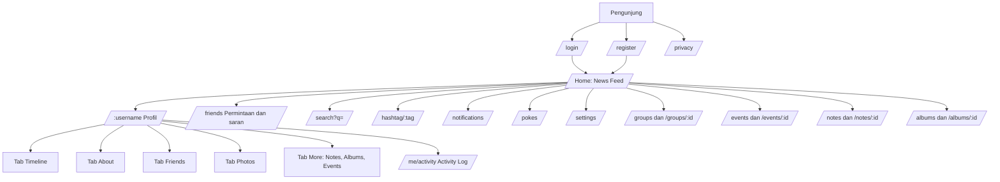
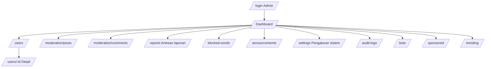
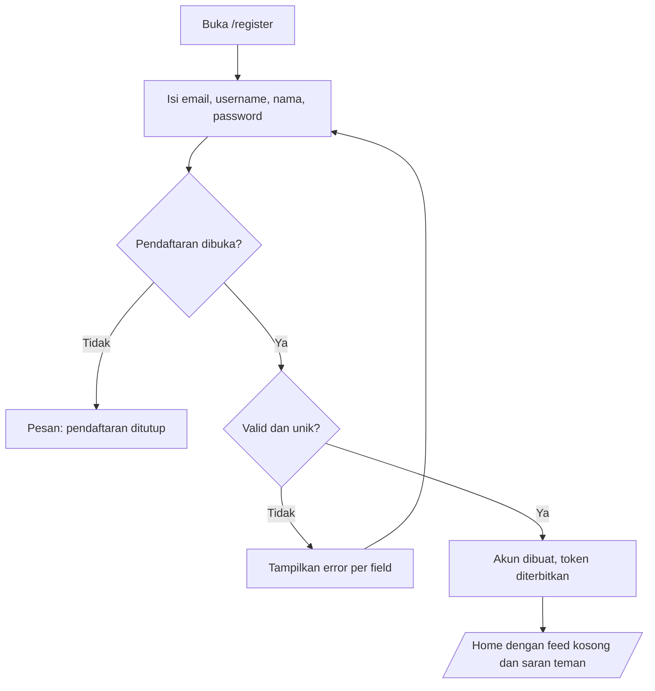
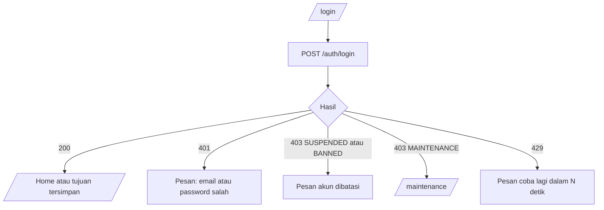
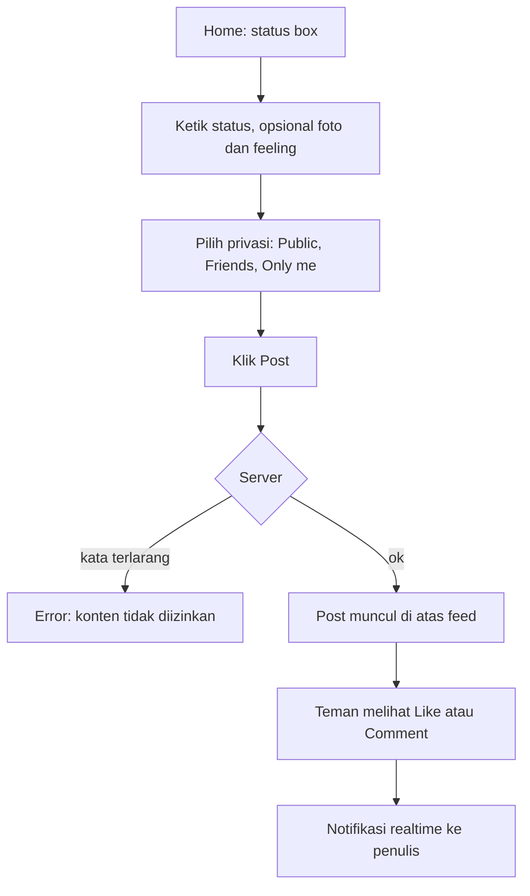
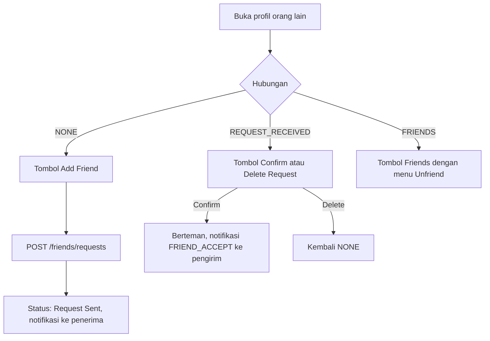
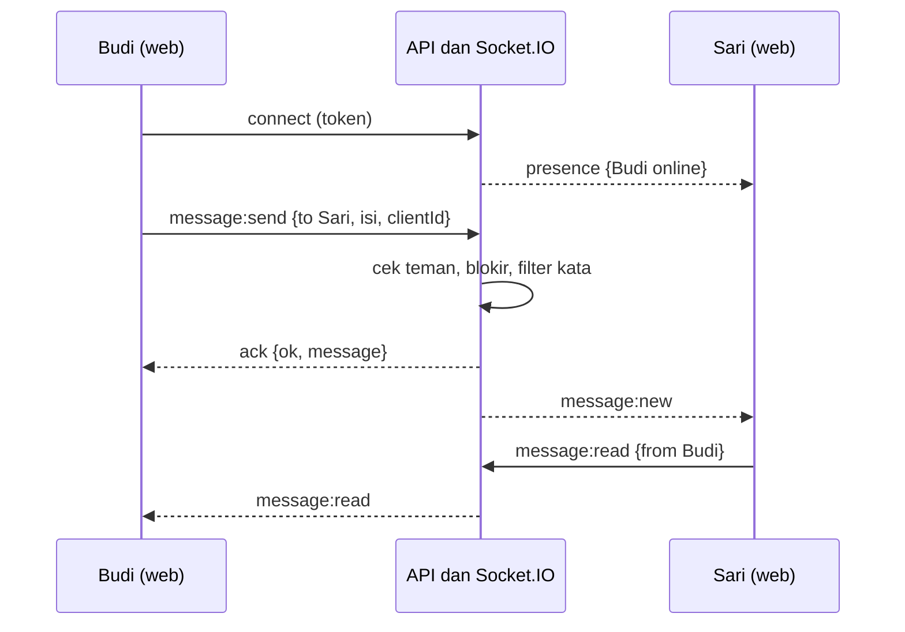
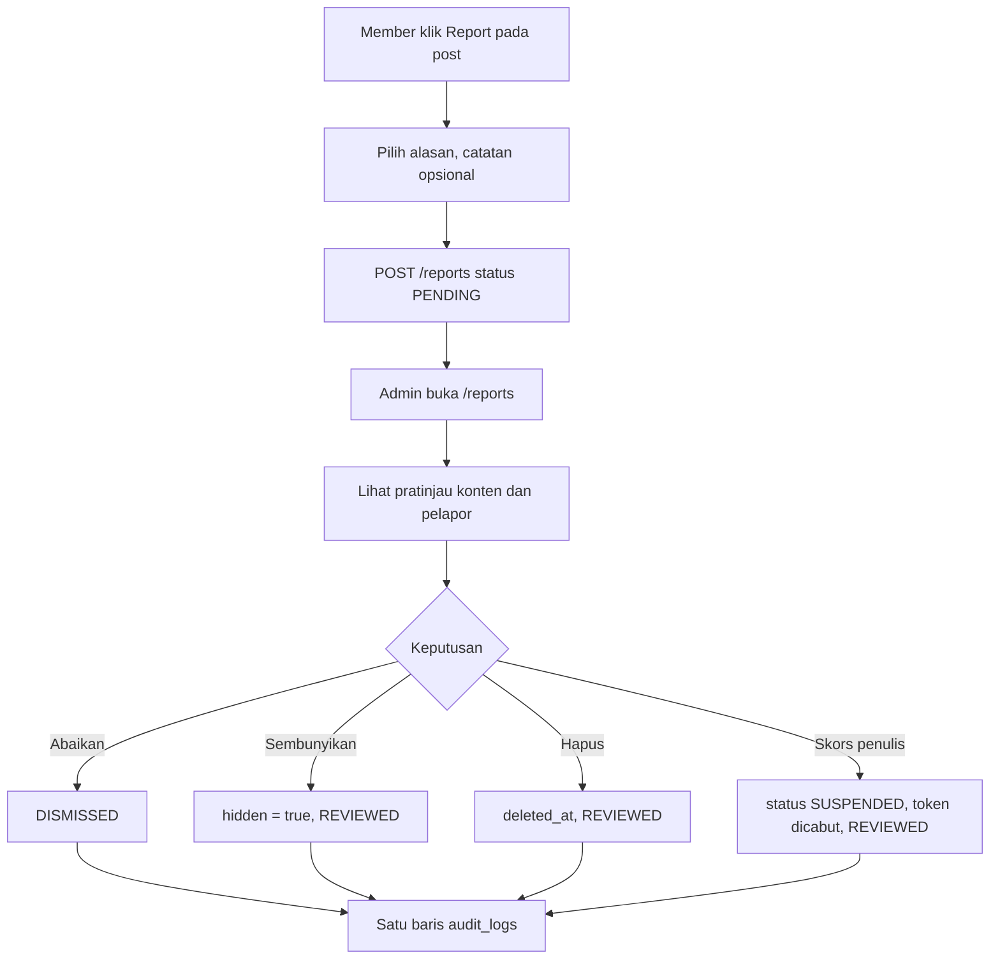

# User Flow dan Sitemap: Retro Social Network 2015 + Admin Panel

Dibuat 2026-11-24 · Ganjar Hadiatna · Status: draf 1

Dokumen ini memetakan halaman, rute, dan alur utama. Diagram memakai Mermaid, yang tampil otomatis di GitHub dan VS Code (dengan ekstensi Markdown Mermaid). Kode kebutuhan merujuk ke [PRD](02-prd.md) dan endpoint ke [API Spec](04-api-spec.md).

## 1. Sitemap user app (`apps/web`)

### Tabel rute

| Rute | Halaman | Auth | Fase | PRD |
|---|---|---|---|---|
| `/login` | Login dan ajakan daftar | tamu | 1 | AUTH-02 |
| `/register` | Form daftar, label parodi | tamu | 1 | AUTH-01, UX-12 |
| `/privacy` | Kebijakan privasi dan label parodi | bebas | 1 | UX-12 |
| `/forgot-password`, `/reset-password` | Reset password | tamu | 3 | AUTH-05 |
| `/` | News feed, status box, kolom kanan | member | 1 | POST-04 |
| `/:username` | Profil, tab Timeline | member | 1 | PRF-01 |
| `/:username/about`, `/friends`, `/photos` | Tab profil | member | 1 | PRF-01, 04 |
| `/friends` | Permintaan masuk, saran teman, semua teman | member | 1 | FRD-02, 04, 05 |
| `/search` | Hasil pencarian lengkap | member | 2 | SRC-01 |
| `/hashtag/:tag` | Post dengan hashtag | member | 2 | POST-10 |
| `/notifications` | Daftar notifikasi penuh | member | 2 | NTF-01 |
| `/pokes` | Poke yang menunggu | member | 2 | POK-01 |
| `/posts/:id` | Satu post (tujuan tautan notifikasi) | member | 1 | POST-04 |
| `/settings` | Akun, privasi, blokir, hapus akun | member | 3 | PRF-06, FRD-06, AUTH-06 |
| `/me/activity` | Activity log | member | 3 | ACT-01 |
| `/albums`, `/albums/:id` | Album foto | member | 3 | ALB-01 |
| `/groups`, `/groups/:id` | Grup | member | 3 | GRP-01 |
| `/events`, `/events/:id` | Event dan RSVP | member | 3 | EVT-01 |
| `/notes`, `/notes/:id` | Notes | member | 3 | NOT-01 |
| `/maintenance` | Halaman pemeliharaan | bebas | 2 | BR-12 |
| `*` | 404 bergaya retro | bebas | 1 | n/a |

Rute `/:username` ada di akar, jadi daftar kata yang dilarang sebagai username harus mencakup semua segmen rute di atas (`friends`, `search`, `settings`, `notifications`, `login`, `register`, `privacy`, `hashtag`, `groups`, `events`, `notes`, `albums`, `pokes`, `posts`, `admin`, `api`, `uploads`, `maintenance`). Validasi ini ditambahkan di AUTH-01.

### Penjaga rute (router guard)

| Kondisi | Tindakan |
|---|---|
| Belum login membuka halaman member | Arahkan ke `/login`, simpan tujuan, kembali setelah login |
| Sudah login membuka `/login` atau `/register` | Arahkan ke `/` |
| Refresh token gagal (401 setelah refresh) | Bersihkan sesi, ke `/login` dengan pesan "Sesi berakhir" |
| Respons 403 `ACCOUNT_SUSPENDED` atau `ACCOUNT_BANNED` | Tampilkan pesan di login, sesi dibersihkan |
| Respons 403 `MAINTENANCE_MODE` | Ke `/maintenance` |
| Respons 404 pada profil (privasi atau blokir) | Halaman "Konten ini tidak tersedia" tanpa membedakan sebabnya |

## 2. Sitemap admin panel (`apps/admin`)

| Rute | Halaman | PRD |
|---|---|---|
| `/login` | Login admin; user biasa ditolak | ADM-01 |
| `/` | Dashboard: kartu angka dan dua grafik | ADM-02 |
| `/users`, `/users/:id` | Daftar, filter, aksi status dan role | ADM-03 sampai 07 |
| `/moderation/posts` | Daftar post dengan filter hidden, reported, deleted | ADM-08 |
| `/moderation/comments` | Idem untuk komentar, aksi massal | ADM-09 |
| `/reports` | Antrean laporan, putuskan di tempat | ADM-10 |
| `/blocked-words` | Tambah dan hapus kata | ADM-11 |
| `/settings` | Maintenance mode, buka atau tutup pendaftaran | ADM-12 |
| `/announcements` | Pengumuman | ADM-13 |
| `/audit-logs` | Jejak aksi admin, hanya baca | ADM-14 |
| `/bots`, `/sponsored`, `/trending` | Bonus | ADM-15 sampai 17 |

Admin panel tidak punya halaman register; admin pertama dibuat lewat seed atau CLI (ADM-01).

## 3. Alur utama

### 3.1 Daftar dan masuk pertama kali (Fase 1)

Feed kosong tidak boleh terasa mati: tampilkan kartu "People You May Know" dan ajakan menulis status pertama.

### 3.2 Login dan pemulihan sesi

Saat access token kedaluwarsa di tengah pemakaian, interceptor menahan request, memanggil `/auth/refresh` sekali, lalu mengulang request. Banyak request bersamaan berbagi satu panggilan refresh.

### 3.3 Menulis status dan berinteraksi

### 3.4 Berteman

### 3.5 Chat 1-ke-1 (Fase 2)

Bila socket putus, pesan dikirim lewat `POST /messages/:userId` dan antrean dikirim ulang saat tersambung kembali; `clientId` mencegah pesan ganda.

### 3.6 Laporan dan moderasi (inti nilai admin)

Target ukuran keberhasilan: dari membuka antrean sampai keputusan tercatat tidak lebih dari tiga klik.

### 3.7 Hapus akun (Fase 3)

`/settings` lalu "Delete account", masukkan password, konfirmasi. Server soft delete, mencabut semua refresh token, dan menjadwalkan anonimisasi setelah masa tunggu (usulan 30 hari, BR-06). Selama masa tunggu, login dalam rentang itu membatalkan penghapusan (keputusan terbuka).

## 4. Matriks akses

| Kemampuan | Pengunjung | Member | Admin |
|---|---|---|---|
| Lihat login, register, privacy | ya | ya | ya |
| Baca dan tulis konten, chat, berteman | tidak | ya (sesuai privasi) | ya |
| Lihat konten `hidden` | tidak | tidak | ya |
| Admin panel dan `/api/admin/*` | tidak | tidak (403) | ya |
| Saat maintenance mode | halaman maintenance | halaman maintenance | tetap bisa masuk |

## 5. Status kosong dan error yang harus dirancang

| Situasi | Tampilan |
|---|---|
| Feed kosong | Kartu saran teman dan ajakan menulis status |
| Belum punya teman di sidebar chat | Teks "Tambah teman untuk mulai mengobrol" |
| Hasil pencarian kosong | "Tidak ada hasil untuk ..." |
| Profil tidak tersedia (privasi, blokir, BANNED) | Halaman "Konten ini tidak tersedia" |
| Gambar gagal dimuat | Avatar atau placeholder bawaan |
| Socket terputus | Titik chat menjadi abu dan coba sambung ulang tanpa pesan error yang mengganggu |
| 429 | Pesan jeda dengan hitung mundur |
